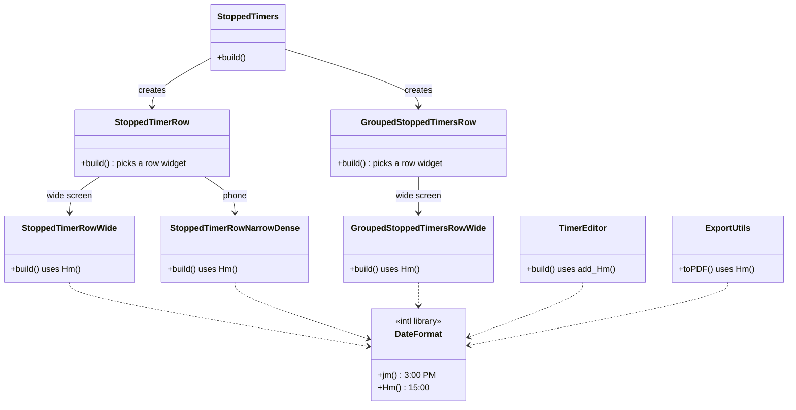
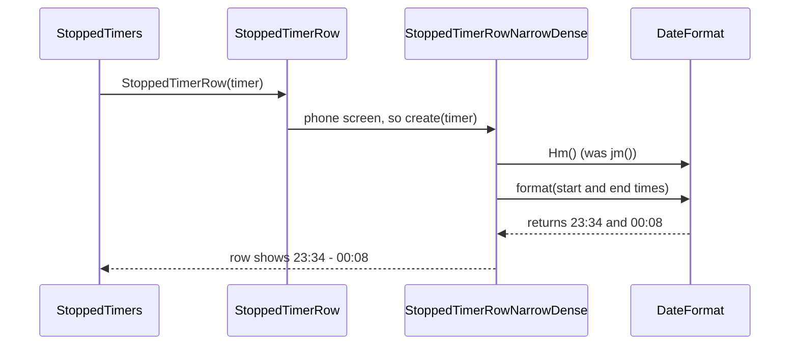

# Design Document (Time Cop)

## Overview of the Change and Relevant Code Structure

We changed Time Cop to use 24-hour time everywhere. Issue [#158](https://github.com/hamaluik/timecop/issues/158) ("Option for 24 hour time") pointed out that the app mixed 12-hour and 24-hour time. The time picker used 24-hour dials, but after a user picked a time, the app showed it in 12-hour time with AM/PM.

Every place that showed a time of day used `DateFormat.jm()` (12-hour). We swapped each one for `DateFormat.Hm()` (24-hour):

- **`TimerEditor.dart`:** edit screen
- **`StoppedTimerRowWide.dart`:** timer list on tablets and computers
- **`StoppedTimerRowNarrowDense.dart`:** timer list on phones
- **`GroupedStoppedTimersRowWide.dart`:** grouped timers on tablets and computers
- **`export_utils.dart`:** PDF export

Each of these formats the timer's `startTime` and `endTime` itself when it draws, so no data or settings code changed.

## Diagrams

### Class diagram

The five classes that call `DateFormat` are the ones we changed.

### Sequence diagram

How a phone draws one finished timer. Before the change, the row read `11:34 PM - 12:08 AM`.

## Key Design Decisions

### Decision 1: Change all instances to 24-hour, or just a few?

**Problem:** The time picker used 24-hour time, but the text shown after picking used 12-hour time, so one screen mixed both formats.

**Options considered:**

- **Change all instances**
  - Pros: Every screen and the PDF export use the same format, so users never see a mix. Matches the issue, which asked for 24-hour time everywhere.
  - Cons: Users lose the 12-hour format.
- **Change only a few instances**
  - Pros: Fewer code changes, so less testing and risk. Leaves more for the maintainer to decide.
  - Cons: The app would still mix formats. For example, the edit screen would show 24-hour time while the timer list showed 12-hour.

**Final decision:** Change all time displays to 24-hour format. The time picker on the edit timer screen already uses 24-hour time, so this keeps the app consistent. If developers later add a switch between 12-hour and 24-hour time, every display will already use the same format.

**Who made the decision:** We (Kaley and Ethan) decided together. After exploring Time Cop and seeing where times appear and how users would see them, we chose to change all instances so the app would be consistent, as the issue requested.
