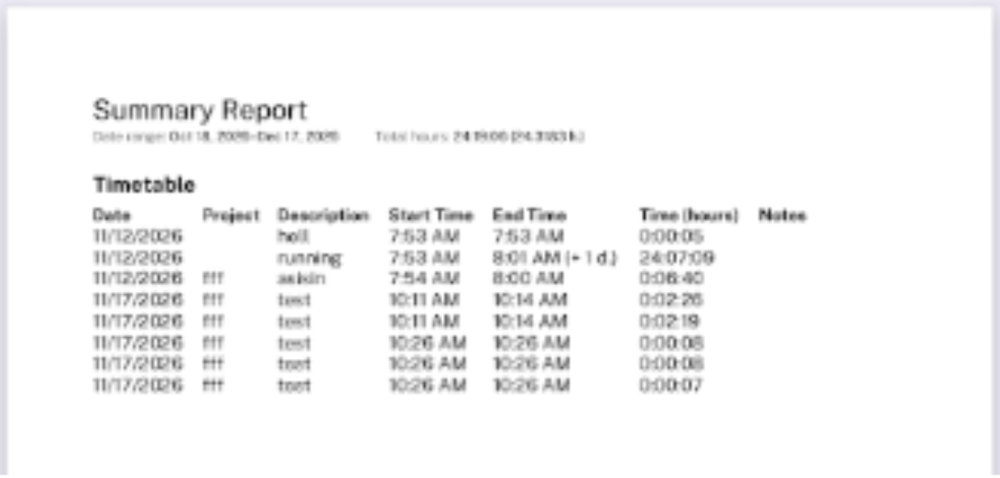
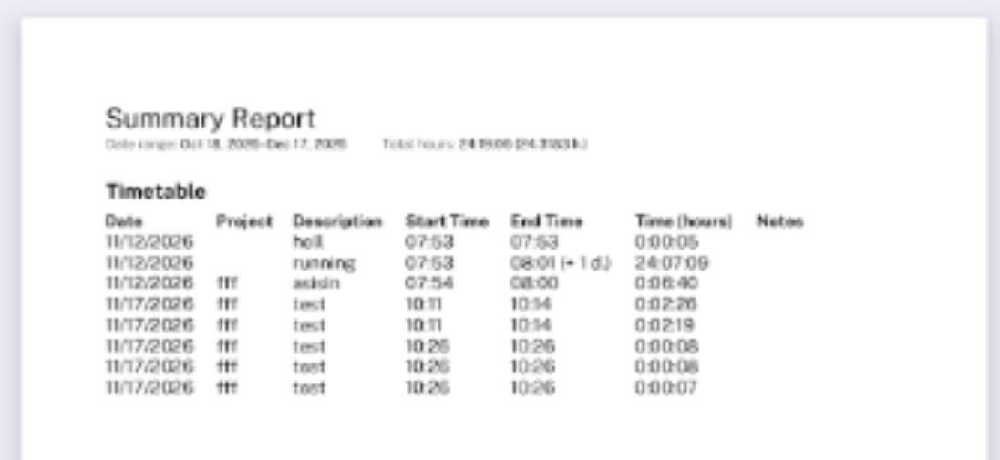

# Process Journal (Time Cop)

**Issue:** https://github.com/hamaluik/timecop/issues/158
**Pull request:** https://github.com/hamaluik/timecop/pull/170
**Authors:** Ethan Pham and Kaley Chung

## 1. Feature Exploration

After building the app, we ran it on the Android emulator and clicked through every screen that shows a time. This confirmed the bug: the time picker on the edit timer screen uses 24-hour dials, but the app shows the chosen time in 12-hour format with AM/PM.

Decisions about the requirements:

- **24-hour everywhere, no setting.** The issue suggested a 12/24-hour toggle as a nicer option. We changed every time display to 24-hour instead, so the app is consistent. A toggle can be added later on top of this.
- **Include PDF exports.** The issue asked for 24-hour time in all instances, so we changed exported PDFs too.
- **Keep the date.** On the edit screen, the time is shown together with the date, so the date has to stay.

## 2. Comprehension Process

1. **Searched for visible text.** Ethan searched globally for labels from the app, like "Start Time" and "Set to Current Time". They led to variables in `terms.flt`, which are used in `TimerEditor.dart`.
2. **Asked AI about the file.** Ethan asked Claude to explain `TimerEditor.dart`. It pointed out that lines using `.add_jm()` format the times. It also explained how the deep indentation shows which widgets contain which elements.
3. **Read the docs for the format.** Kaley Ctrl + clicked `.add_jm()`, which opened `date_format.dart`. Its documentation lists the formats: `jm` is 12-hour with AM/PM, and `Hm` is 24-hour.
4. **Found every place to change.** Kaley searched globally for `add_jm()` and `jm()` to find every time display.
5. **Figured out which screen each file draws.** Discussing with Claude, we learned the `...Wide.dart` files are for tablets and computers, and `StoppedTimerRowNarrowDense.dart` is for phones.

**Techniques and commands**

- Global search in VS Code (Ctrl + Shift + F) and Ctrl + click to jump to definitions.
- `flutter run` to start the app on the emulator, and `r` to hot reload after each change.

**Debugger:** We didn't use breakpoints. We checked each change by hot reloading and looking at the emulator.

## 3. Implementation Process

| Step | Driver | Navigator |
| --- | --- | --- |
| Tested hot reload by changing the title to "HOT RELOAD TEST" | Ethan | Kaley |
| Changed `.add_jm()` to `.add_Hm()` in `TimerEditor.dart`, then fixed the missing date with `yMMMEd().add_Hm()` | Ethan | Kaley |
| Searched for the remaining `jm()` calls and changed them to `Hm()` in the timer list files | Kaley | Ethan |
| Changed `DateFormat.jm()` in `export_utils.dart` and confirmed it affects PDF exports | Ethan | Kaley |
| Investigated why the `Wide` file changes didn't show on the emulator | Kaley | Ethan |

**Switching roles:** We switched by task, depending on who found the next thing to change. We worked over a call with Live Share, so we both saw the same code. Ethan ran the emulator and shared his screen.

**How it affected the work:** One person could focus on editing while the other watched the emulator and spotted what still showed AM/PM.

## 4. Running and Testing

**Manual checks (expected: no AM/PM anywhere, e.g. `15:00` instead of `3:00 PM`)**

- **Hot reload:** changing the title text showed up right away, so we knew edits reached the emulator.
- **Edit timer screen:** the times show in 24-hour format, with the date still there.
- **Timer list (phone):** start and end times show in 24-hour format.
- **PDF export:** we exported before and after the change. The times switched to 24-hour.

**Write → Run → Debug**

- **Changed `.add_jm()` to `.add_Hm()`** → the time became 24-hour, but the date disappeared → added `yMMMEd()` back in front.
- **Changed `jm()` in `export_utils.dart`** → we weren't sure what it affected → compared PDF exports with and without the change.
- **Changed the `Wide` files** → nothing changed on the phone emulator, even after rotating it → learned they're only used on screens wider than a phone, so we kept the change and noted in the PR that we couldn't test it by hand.

## 5. Obstacles Encountered

1. **New language and tools.** Neither of us had used Dart or Flutter. We used the Flutter docs to build and run the app, and Claude and Gemini to explain the code.
2. **The date disappeared.** Replacing `add_jm()` alone removed the date. *Fix:* keep the date part, `DateFormat.yMMMEd().add_Hm()`.
3. **Changes we couldn't see.** The `Wide` row files only run on large screens, so the phone emulator never showed them. *Fix:* we confirmed with Claude which screen each file draws, kept the one-line change, and said in the PR that it wasn't tested by hand.
4. **The co-author line wasn't recognized.** In PowerShell, the `<` and `>` around the email kept disappearing from the commit message. *Fix:* added them with `[char]60` and `[char]62`, amended the commit and force pushed.

## 6. Resources Consulted

- **Claude:** explained `TimerEditor.dart`, which files draw which screens, and what `export_utils.dart` does.
- **Gemini:** used for code comprehension in the same way, on specific lines and files.
- **Flutter documentation:** how to build and run the app.
- **`date_format.dart` documentation** (in the `intl` package): the difference between `jm` and `Hm`.

We used AI chatbots, not an AI coding agent. The changes were small enough to make ourselves.

## 7. Reflection

**How we used AI:** We each asked chatbots (Claude and Gemini) to explain specific lines or files when we were stuck. We made and tested every change ourselves.

**Managing context while pair programming:** We worked over a call with Live Share, so changes showed up for both of us right away, without passing commits back and forth. Ethan built and ran the emulator and shared his screen, so we were always looking at the same result.

**What we learned from writing this journal:** Writing down each step made it clear why we made each change, like keeping the date or including PDF exports. It also gave us notes to put in the PR, such as the screens we couldn't test.

**Takeaways:**

- Don't be afraid of unfamiliar tools like Dart and Flutter. Existing docs and AI explanations make them learnable.
- Test that your setup works first. A quick hot reload test saved us from guessing whether changes were showing up.
- If you can't test something, say so in the PR instead of skipping it.
